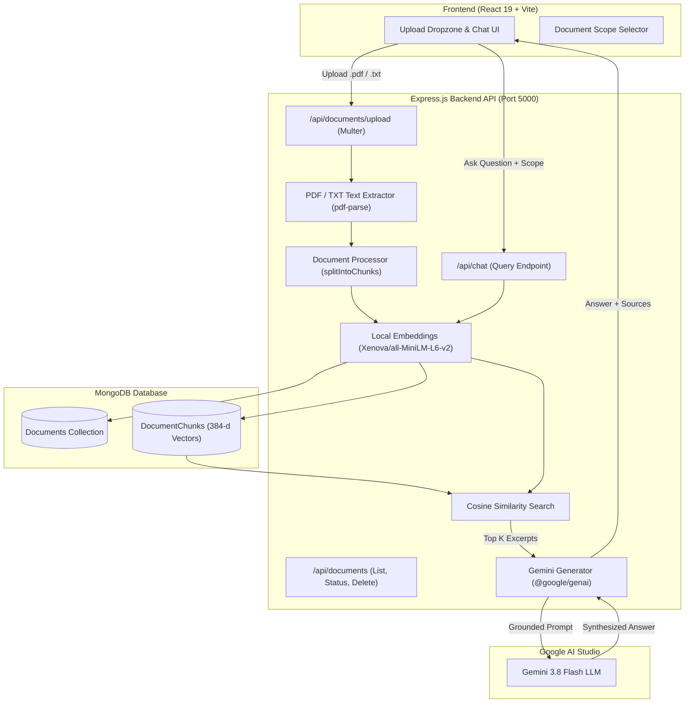

# DocuMind AI — Full-Stack Document RAG Platform (MERN + Gemini API)

A full-stack, production-ready Retrieval-Augmented Generation (RAG) web application built with the MERN stack (MongoDB, Express, React, Node.js), local vector embeddings, and Google's Gemini LLM.

---

## 1. Project Overview

This application allows users to upload real PDF and TXT documents, automatically extract their text, split them into overlapping chunks, generate 384-dimensional dense vector embeddings locally on the CPU using `@xenova/transformers`, store the documents and vector chunks persistently in MongoDB, and query them with semantic search. Relevant context chunks are retrieved via cosine similarity and forwarded to Google Gemini (`gemini-3.8-flash`) to synthesize grounded, truthful answers with full source traceability.

---

## 2. Architecture



---

## 3. Technology Stack

- **Frontend**: React 19, Vite, Lucide Icons, Glassmorphic CSS Design System.
- **Backend**: Node.js (ES Modules), Express.js, Multer (in-memory buffer parsing).
- **Text Extraction**: `pdf-parse` (pure TypeScript multi-page parser) & native UTF-8 stream decoding.
- **Embeddings**: Local inference via `@xenova/transformers` with `Xenova/all-MiniLM-L6-v2` (384 dimensions, zero external API cost).
- **Database**: MongoDB with Mongoose ODM (models: `Document`, `DocumentChunk` with compound indexes).
- **LLM Synthesis**: `@google/genai` SDK using `gemini-3.8-flash` (free tier via Google AI Studio).

---

## 4. Prerequisites

1. **Node.js**: v20 or higher.
2. **MongoDB**: Local MongoDB instance running on `mongodb://127.0.0.1:27017` (or MongoDB Atlas connection string).
3. **Gemini API Key**: Free API key from [Google AI Studio](https://aistudio.google.com/app/apikey).

---

## 5. Installation and Setup

### 1. Backend Setup
```bash
cd backend
npm install
```

Create or update `backend/.env`:
```env
PORT=5000
MONGO_URI=mongodb://127.0.0.1:27017/mern_dev_db
NODE_ENV=development
GEMINI_API_KEY=your_actual_gemini_api_key_here
GEMINI_MODEL=gemini-3.8-flash
```

### 2. Frontend Setup
```bash
cd ../frontend
npm install
```

---

## 6. Running the Servers

### Start Backend Development Server (Port 5000)
```bash
cd backend
npm run dev
```

### Start Frontend Development Server (Port 5173)
```bash
cd frontend
npm run dev
```
Open your browser at `http://localhost:5173`. Vite automatically proxies `/api/*` calls to the Express backend on port 5000.

---

## 7. Testing Suite

All tests are located in `backend/RAG` and can be run independently:

```bash
cd backend/RAG
```

| Test Command | What It Verifies |
| :--- | :--- |
| `node testDocumentRAG.js` | **Complete System Test:** TXT & PDF ingestion, chunking, local embeddings, MongoDB persistence, scoped similarity retrieval, error validation, and cascade deletion. |
| `node testGeminiRAG.js` | **Gemini Pipeline Test:** Verifies `@google/genai` API connection, prompt grounding, and answer generation. |
| `node testSearch.js` | Semantic retrieval using cosine similarity over local vector store. |
| `node testSimilarity.js` | Cosine similarity calculation between normalized vectors. |
| `node testVectorStore.js` | In-memory vector store creation and dimensions. |
| `node testEmbedding.js` | Local embedding generation with `Xenova/all-MiniLM-L6-v2`. |
| `node testChunking.js` | Text cleaning and overlapping window chunking. |

---

## 8. API Reference

### Document Endpoints
- `POST /api/documents/upload`: Upload multipart form data with field `file` (`.pdf` or `.txt`, max 15MB).
- `GET /api/documents`: List all uploaded documents with status and metadata.
- `GET /api/documents/:id/status`: Check processing status and chunk counts.
- `DELETE /api/documents/:id`: Deletes the document and all associated vector chunks from MongoDB.

### Chat Endpoint
- `POST /api/chat`:
```json
{
  "question": "What is Retrieval-Augmented Generation?",
  "documentIds": ["optional_document_id"],
  "topK": 3
}
```
Response:
```json
{
  "success": true,
  "data": {
    "question": "What is Retrieval-Augmented Generation?",
    "answer": "Retrieval-Augmented Generation (RAG) is a technique...",
    "sources": [
      {
        "documentId": "6adc35a7cfaeeb2162b319a6",
        "originalName": "guide.pdf",
        "chunkIndex": 0,
        "text": "Retrieval-Augmented Generation combines...",
        "score": 0.7421
      }
    ]
  }
}
```

---

## 9. Security and Cost Considerations

- **Secrets Security**: `GEMINI_API_KEY` is loaded strictly on the backend and never exposed in browser bundles, responses, or Git repository files.
- **Untrusted Context**: Retrieved text from uploaded documents is passed as untrusted data within strict system instruction boundaries, mitigating prompt injection attacks.
- **Free-First Policy**: Embeddings are generated 100% locally on your machine with zero API fees. Gemini API operates under the free tier (up to 15 requests/minute) on Google AI Studio.
- **Memory Safety**: File uploads are processed in memory and chunked with bounded context limits to avoid buffer overflow or memory leaks.

---

## 10. Known Limitations

- **OCR Not Included**: Scanned or image-only PDFs that contain no text streams require an Optical Character Recognition (OCR) engine (such as Tesseract), which is not included in this release.
- **Local CPU Latency**: The first call to `@xenova/transformers` downloads the ~90MB ONNX model weights to the local cache. Subsequent calls run fast and offline.
