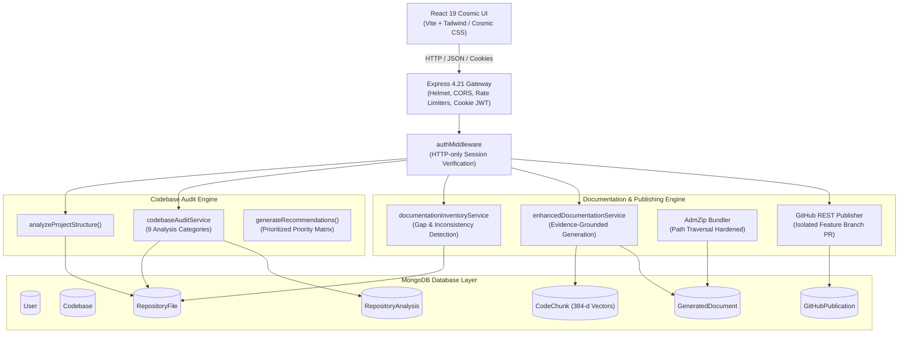

# DevMind AI — AI Codebase Auditor Architecture

**Feature Name:** AI Codebase Auditor  
**Tagline:** Understand Your Code. Discover What's Missing. Improve With Confidence.  
**Version:** 2.1.0  
**Status:** Implemented & Verified  

---

## 1. System Overview

The **AI Codebase Auditor** extends the DevMind AI platform from codebase retrieval and semantic search into an automated architecture assessment, vulnerability identification, documentation gap detection, and safe GitHub publication platform.

```
 GitHub Repository URL (or Uploaded ZIP)
                 ↓
      Repository Import & Ingestion
                 ↓
  Code-Aware Indexing (384-d MiniLM Vector Chunks)
                 ↓
    Deterministic Project Structure Analysis
                 ↓
    Multi-Category Static Codebase Audit
                 ↓
     Interactive Cosmic Analysis Dashboard
                 ↓
       Documentation Inventory & Gap Analysis
                 ↓
      Evidence-Grounded Document Generation
                 ↓
       Markdown Review & In-Place Workspace
                 ↓
 Download Bundle (ZIP) OR Safe GitHub Pull Request (Isolated Branch)
```

---

## 2. Architectural Principles

1. **Evidence-Grounded Findings:** Every reported finding links to actual repository files, concrete line ranges, and authentic source code excerpts. The system never fabricates CVE identifiers, benchmark figures, or synthetic metrics.
2. **Context-Aware Auditing:** Frameworks and patterns are evaluated according to the actual project type (Node.js, React, Python, Spring Boot, CLI tool, or monorepo). Missing JWT or database schemas are not flagged on static sites or CLI utilities.
3. **Multi-Tenant Data Isolation:** All MongoDB collections (`RepositoryAnalysis`, `GeneratedDocument`, `GitHubPublication`) maintain strict `ownerUserId` foreign-key indices and are guarded by server-side query filters.
4. **Safe-by-Default GitHub Publishing:** The system **never** pushes directly to default branches (`main`/`master`). All publications generate dedicated branches (`devmind/docs-update-YYYY-MM-DD-<rand>`) and open pull requests for developer review and merge.
5. **Free-First & Local-First:** Embeddings run locally via `@xenova/transformers` (all-MiniLM-L6-v2, 384 dimensions); audit passes operate on deterministic AST and regex patterns; and LLM synthesis supports Google Gemini with fallback to a deterministic `MockLLMProvider`.

---

## 3. High-Level System Architecture



---

## 4. Logical Components & Responsibilities

### 4.1 Backend Services

| Service Name | Primary Responsibilities |
| :--- | :--- |
| `codebaseAuditService.js` | Analyzes project structure, detects manifests/frameworks/languages, runs 9 static audit categories, ranks recommendations by severity and effort. |
| `documentationInventoryService.js` | Scans for required engineering docs (README, ARCHITECTURE, PRD, API, SECURITY, etc.), classifies statuses (`MISSING`, `PRESENT_AND_REVIEWED`, `PRESENT_BUT_INCOMPLETE`), detects code/doc drift. |
| `enhancedDocumentationService.js` | Synthesizes grounded markdown docs using LLM abstraction; guarantees reverse-engineered PRD labeling and prompt-injection guardrails. |
| `githubService.js` | Validates GitHub repository URLs, downloads zipball streams safely, fetches repository metadata without authentication leaks. |
| `codebaseIndexingService.js` | Orchestrates repository extraction, AST symbol chunking, 384-d local vector generation, and cascade deletion. |
| `codebaseRetrievalService.js` | Performs hybrid semantic/lexical search over `CodeChunk` records and answers codebase questions with citations. |

### 4.2 Database Models

| Model | Schema & Indexing | Purpose |
| :--- | :--- | :--- |
| `RepositoryAnalysis` | Indexed on `{ ownerUserId: 1, repositoryId: 1, createdAt: -1 }` | Stores detected stack, findings array, recommendations, category summaries, and completion metadata. |
| `GeneratedDocument` | Compound index on `{ ownerUserId: 1, repositoryId: 1, documentPath: 1 }` | Stores generated documentation, user edits, hash verification, validation warnings, and publication status. |
| `GitHubPublication` | Indexed on `{ ownerUserId: 1, repositoryId: 1, createdAt: -1 }` | Audit trail of branches created, PR numbers, URLs, and published file manifests. |
| `Codebase` | Indexed on `{ ownerUserId: 1, status: 1, createdAt: -1 }` | Metadata for imported repositories, indexing progress, lines of code, and language distribution. |
| `RepositoryFile` | Indexed on `{ repositoryId: 1, ownerUserId: 1, relativePath: 1 }` | Cleaned source code files with secrets redacted and SHA-256 content hashes. |
| `CodeChunk` | Indexed on `{ repositoryId: 1, ownerUserId: 1 }` | Semantic code blocks with 384-dimensional local vector embeddings. |

---

## 5. Audit Categories & Methodology

The auditor evaluates repositories across 9 discrete, evidence-grounded categories:

1. **Architecture & Structure:** Module decomposition, directory hierarchy, separation of concerns, global error handling.
2. **Authentication & Authorization:** Context-aware authentication analysis. Checks JWT signing, hardcoded secrets, password hashing algorithms, `httpOnly`/`secure`/`sameSite` cookie settings, and session storage.
3. **API & Backend Quality:** Unhandled asynchronous promises in route handlers, input sanitization, rate limiting on critical routes, security header middleware.
4. **Frontend Quality:** Component modularity, state management consistency, API error boundaries, hardcoded URLs and configuration strings.
5. **Database & Data Security:** Schema validation rules, connection configuration, query injection hazards, sensitive field storage.
6. **Dependencies & Supply Chain:** Manifest analysis, missing lockfiles (`package-lock.json`, `pnpm-lock.yaml`, `yarn.lock`), wildcard version declarations, unpinned dependencies.
7. **Testing & Reliability:** Detection of test runners (Jest, Mocha, Vitest, PyTest), test scripts in manifests, mock fixtures.
8. **Deployment & DevOps:** Dockerfiles, CI/CD pipelines (`.github/workflows`), environment variable templates (`.env.example`), production process configs.
9. **Performance & Maintainability:** Large monolithic files (>500 lines), repeated expensive loops, synchronous blocking operations.

---

## 6. Frontend Dashboard Architecture

The frontend is implemented in React 19 within the existing cosmic dark-mode theme (`#050509` background, neon cyan/purple accents):

- **`AuditDashboard.jsx`**: Main auditor view containing:
  - Repository header with branch, commit SHA, and technology badges.
  - Quick action controls (`Start Analysis`, `Re-analyze`).
  - Overview metrics grid (Critical, High, Medium, Low/Info counts, detected tech stack).
  - Findings list with multi-criteria filtering (Severity, Category, Verification Status).
  - Finding detail drawer with line range badges and code excerpt previews.
  - Actionable recommendations ranked by numerical priority, effort, and risk.
  - Documentation inventory dashboard showing completion states.
  - In-browser markdown review editor with split preview and in-place editing.
  - One-click file and ZIP bundle download controls.
  - Safe GitHub Pull Request dialog with transient token input.
  - Historical audit run explorer.
- **Deep Code Navigation:** Clicking any file location in the findings list automatically switches to the `Code Explorer & Viewer` tab and highlights the exact start/end line range.
