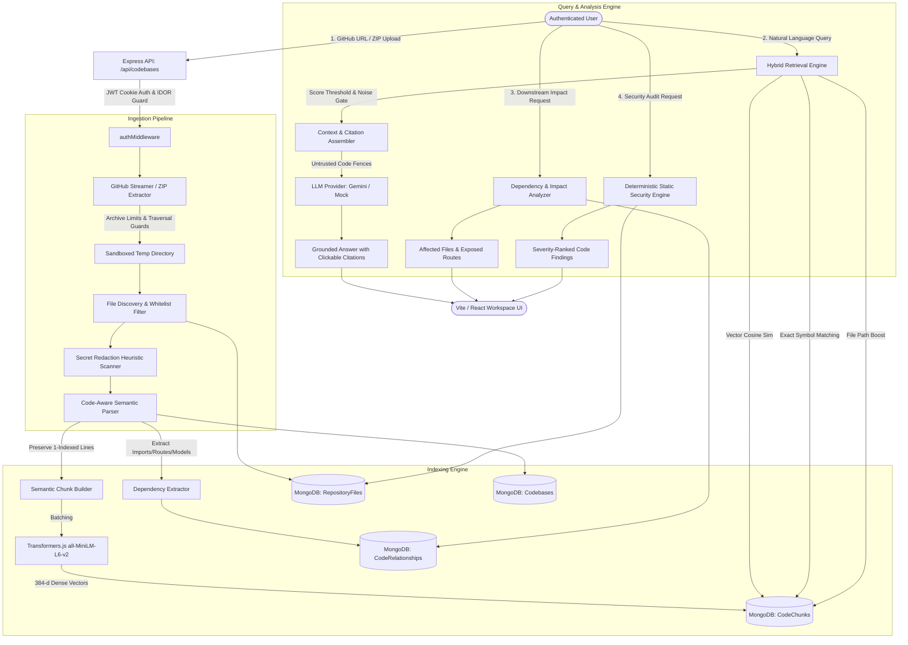

# DevMind AI: Technical Architecture Specification

## 1. System Overview & Philosophy
DevMind AI is an enterprise codebase intelligence and developer assistant engine designed as a first-class extension of the existing MERN RAG platform.

### Core Architectural Principles
1. **Free-First & Replaceable:** All embedding operations use local open-source models via Transformers.js (`all-MiniLM-L6-v2`) with 0 external API costs.
2. **Zero Code Execution:** Untrusted user code is parsed statically; no arbitrary scripts, build steps, or package installations are executed.
3. **Evidence-Grounded Intelligence:** Answers strictly cite original, 1-indexed file lines. If evidence is lacking, the engine honestly abstains.
4. **Strict Multi-Tenancy:** All repositories, files, vector chunks, and relationship graphs are partitioned by `ownerUserId`.

---

## 2. End-to-End Architecture Flow



---

## 3. Subsystem Breakdown

### 3.1 Ingestion & Discovery Pipeline
* **GitHub Ingestion (`githubService.js`):** Validates repository owner, repository name, and branch. Fetches archive tarballs via the GitHub API without requiring user PATs for public repositories.
* **ZIP Extractor (`zipExtractionService.js`):** Enforces safe extraction into a temporary sandbox with path traversal blocking, expansion ratio checks (max 20x), archive size caps (50MB compressed, 100MB uncompressed), and entry count limits (2,500).
* **File Discovery (`fileDiscoveryService.js`):** Whitelists common programming languages (JavaScript, TypeScript, Python, Go, Rust, Java, C/C++, HTML, CSS, JSON, YAML, SQL, Shell, Markdown, Dockerfile) while ignoring `node_modules`, `.git`, `dist`, `build`, `vendor`, and binary assets.
* **Secret Redaction:** Heuristically detects and redacts AWS credentials, GitHub tokens, database connection strings, and private keys before persistence.

### 3.2 Parsing & Embedding Engine
* **Semantic Code Chunking (`codeParserService.js`):** Detects functions, methods, classes, and exported blocks. Assigns exact 1-indexed `startLine` and `endLine` matching the original file.
* **Local Embedding (`embeddingService.js`):** Embeds source chunks into 384-dimensional dense vectors using Xenova Transformers `all-MiniLM-L6-v2`. Vectors are validated before persistence in MongoDB.

### 3.3 Hybrid Retrieval & Grounded RAG
* **Hybrid Scoring Engine (`codebaseRetrievalService.js`):**
  $$\text{Score} = (\text{Vector Cosine} \times 0.65) + (\text{Symbol Match} \times 0.20) + (\text{Path Match} \times 0.15)$$
* **Noise Filter & Abstention:** Rejects candidates scoring below $0.25$. Refuses to fabricate answers when code evidence is missing.
* **Clickable Citations:** Cites format `filePath:startLine-endLine`, enabling immediate 1-click navigation to highlighted lines in the frontend Code Viewer.

### 3.4 Dependency & Downstream Impact Engine (`dependencyService.js`)
* Statically extracts relationships:
  * `imports` / `exports`
  * `defines_route` (Express HTTP route registrations)
  * `uses_model` (Mongoose schema references)
* Given a target module or function, traces incoming edges to construct a blast-radius report of affected files and exposed HTTP routes.

### 3.5 Deterministic Security Engine (`securityAnalysisService.js`)
* Statically inspects repository files for dangerous dynamic execution (`eval`, `new Function`), injection vulnerabilities, insecure CORS origins, and unencrypted session cookies. Every finding includes exact line numbers, code excerpts, risk explanations, and remediations.

### 3.6 Frontend Workspace (`CodebasesView.jsx` & `CodebaseDetailView.jsx`)
* **Codebases Dashboard:** Displays repository cards, status badges, indexing progress bars, and modal forms for GitHub and ZIP imports.
* **Detail Workspace:**
  * **Code Explorer:** Searchable file tree with monospaced code viewer and citation line highlights.
  * **Codebase Chat:** Grounded Q&A assistant with suggested prompt chips and clickable source citations.
  * **Dependency Explorer:** Graph table and downstream impact analysis.
  * **Security Audit:** Severity-ranked vulnerability findings with code excerpts.
  * **Documentation Generator:** Markdown generator for architecture, API catalogs, database schemas, and setup instructions.

---

## 4. Local Setup & Configuration

### Environment Variables (`backend/.env`)
```ini
# Server Configuration
PORT=5000
NODE_ENV=development
CLIENT_URL=http://localhost:5173

# Database
MONGO_URI=mongodb://127.0.0.1:27017/mern_dev_db

# JWT Cookie Authentication
JWT_SECRET=your_super_secret_jwt_key_here
JWT_EXPIRES_IN=7d

# LLM Providers (Gemini or Mock)
DEFAULT_LLM_PROVIDER=gemini
GEMINI_API_KEY=your_gemini_api_key_here

# Codebase Ingestion Limits (Optional - safe defaults applied)
MAX_ARCHIVE_SIZE_BYTES=52428800
MAX_EXTRACTED_SIZE_BYTES=104857600
MAX_ARCHIVE_ENTRIES=2500
```

### Running Locally
1. Start MongoDB daemon:
   ```bash
   mongod --dbpath <data-directory>
   ```
2. Start backend server:
   ```bash
   cd backend
   npm install
   node server.js
   ```
3. Start frontend dev server:
   ```bash
   cd frontend
   npm install
   npm run dev
   ```
4. Run automated test suites:
   ```bash
   node backend/RAG/testCodebaseIntelligence.js
   node backend/RAG/testPhaseE.js
   node backend/RAG/testDocumentRAG.js
   ```
